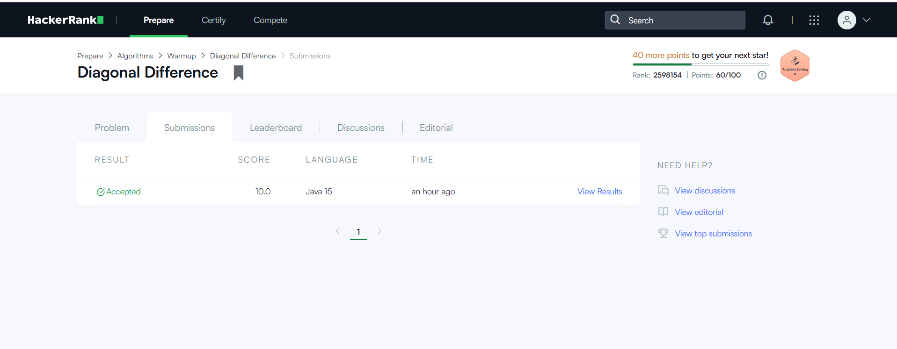
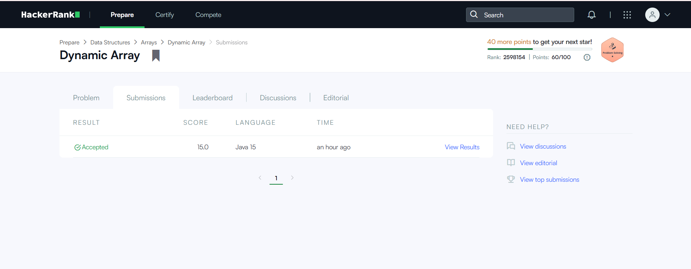
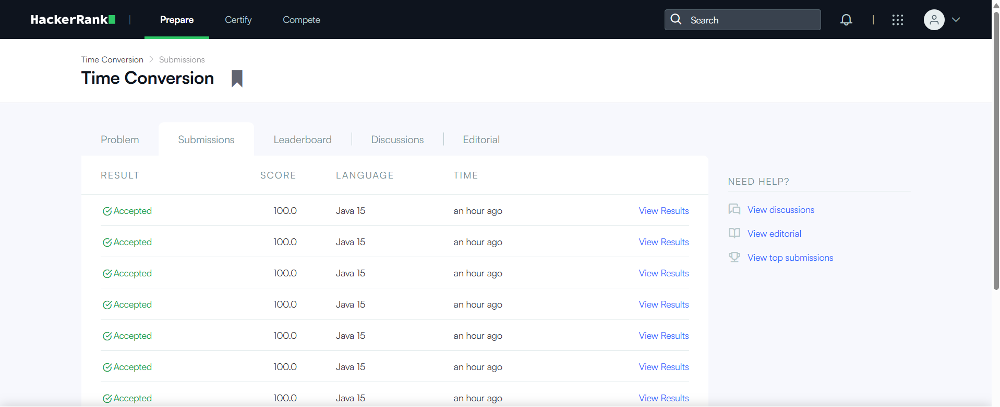
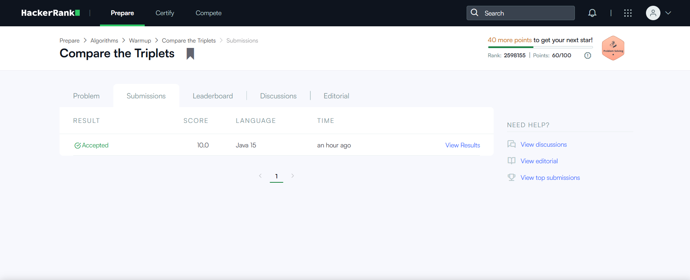
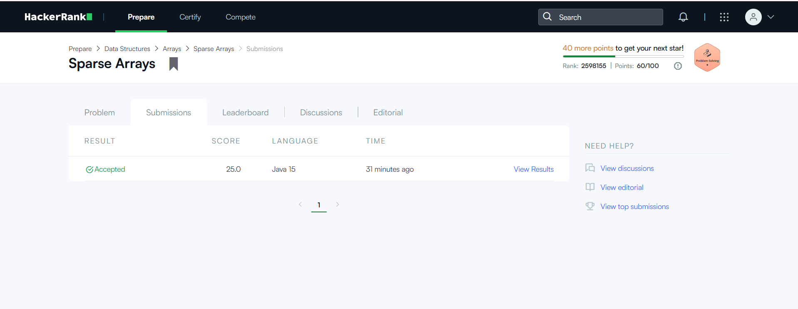

# HackerRank 3rd Semester Portfolio

## About This Project
This repository contains Java solutions for five mandatory HackerRank algorithmic problem-solving challenges completed as part of the 3rd Semester B.Tech CSE Portfolio Building Activity.

## Programming Language
- Java

## HackerRank Profile
Add your HackerRank profile link here.

## Problems and Complexity Analysis

| No. | Problem Name | Time Complexity | Space Complexity |
|---|---|---|---|
| 1 | Diagonal Difference | O(N^2) | O(1) |
| 2 | Dynamic Array | O(N + Q) | O(N + Q) |
| 3 | Time Conversion | O(1) | O(1) |
| 4 | Compare the Triplets | O(1) | O(1) |
| 5 | Sparse Arrays | O(N + Q) average | O(N) |

## Repository Structure

- Diagonal-Difference/Solution.java
- Dynamic-Array/Solution.java
- Time-Conversion/Solution.java
- Compare-the-Triplets/Solution.java
- Sparse-Arrays/Solution.java

## Learning Outcomes
- Understanding arrays and matrix traversal.
- Working with dynamic arrays and lists.
- String manipulation and time conversion.
- Element-wise comparison.
- HashMap-based frequency counting.
- Analyzing time and space complexity.

## Screenshots
Accepted submission screenshots will be added here.

## HackerRank Accepted Submissions

### 1. Diagonal Difference

### 2. Dynamic Array

### 3. Time Conversion

### 4. Compare the Triplets

### 5. Sparse Arrays

## Conclusion
This project helped improve algorithmic thinking, Java programming skills, and problem-solving efficiency.
